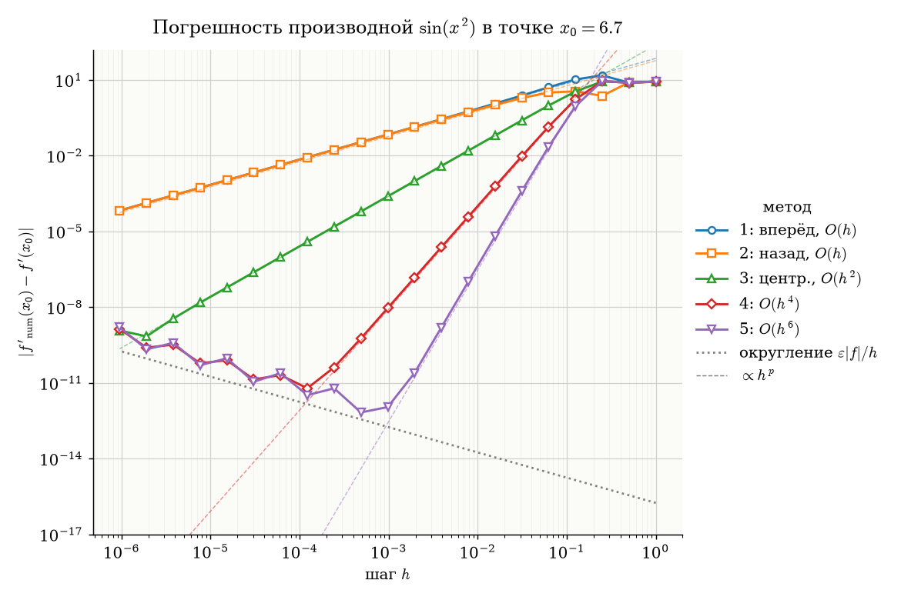
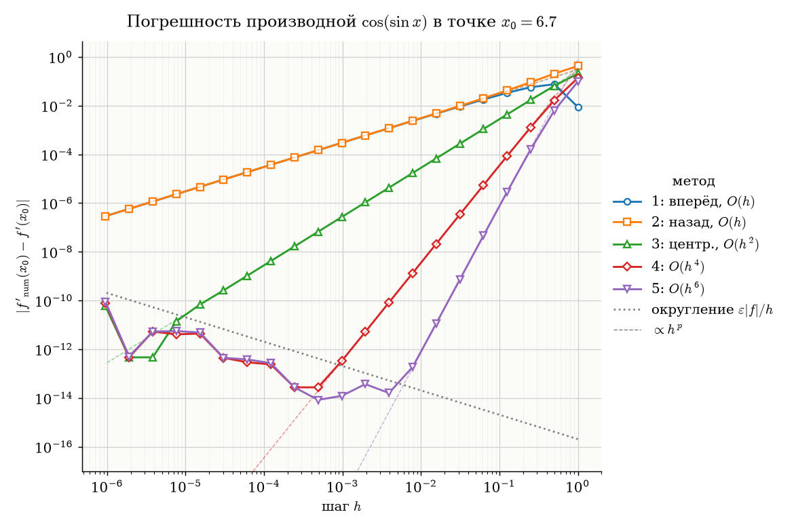
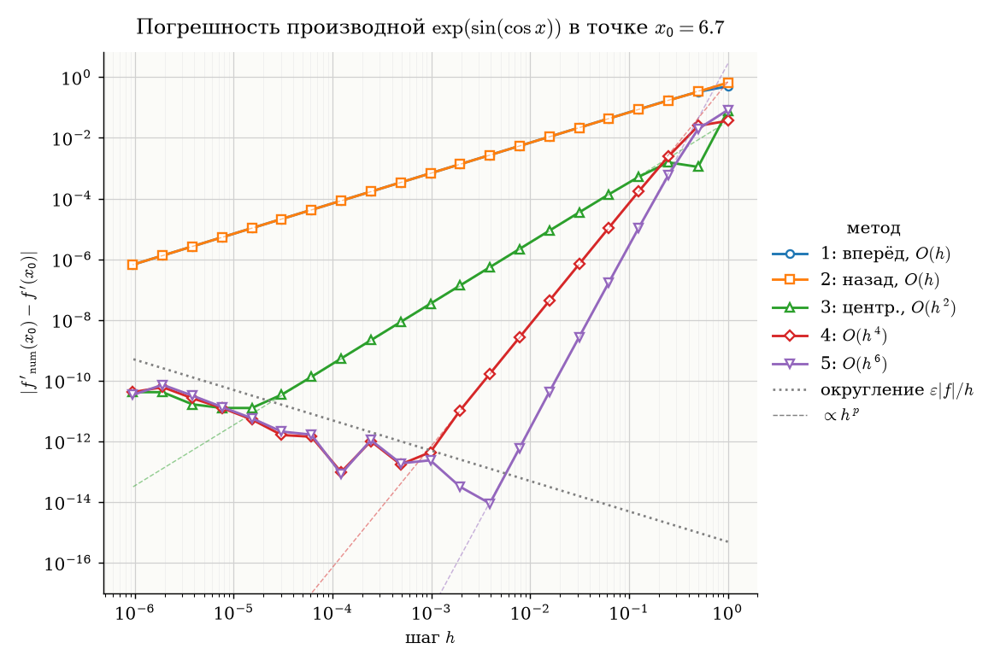
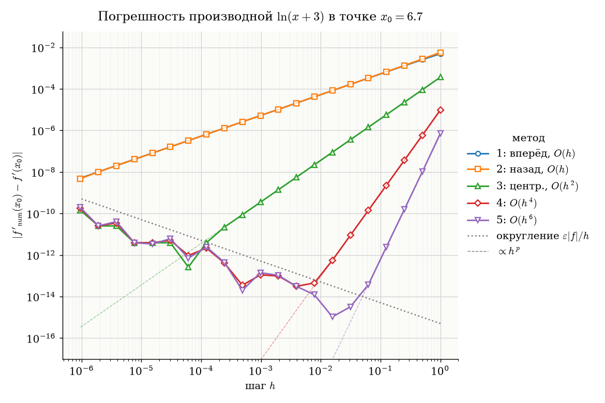
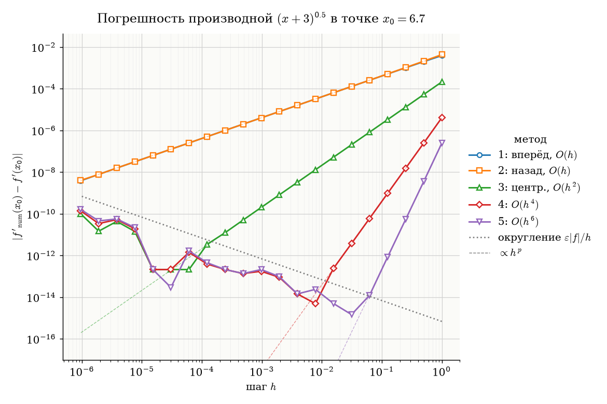

# Лабораторная работа №1. Численное дифференцирование

## 1. Задача

Численное дифференцирование, т.е приближённое вычисление производной $f'(x)$ по значениям функции $f$ в нескольких точках окрестности $x_0$. 
Цель работы: Исследовать, как абсолютная погрешность разностных схем разного порядка зависит от шага $h$, и объяснить эту зависимость.

**Задание.** Построить графики абсолютной погрешности каждого метода численного дифференцирования в зависимости от шага

$$h_n = \frac{2}{2^n}, \quad n = \overline{1, 21}$$

для функций

$$\sin(x^2),\quad \cos(\sin x),\quad \exp(\sin(\cos x)),\quad \ln(x+3),\quad (x+3)^{0.5}.$$

Обе оси логарифмические, графики для каждой функции в отдельном окне. Точное значение производной вычисляется аналитически.

Точка дифференцирования: $x_0 = 6.7$.

## 2. Вывод формул численного дифференцирования

Все формулы получаются из разложения в ряд Тейлора в окрестности точки $x$:

$$f(x + kh) = \sum_{m=0}^{\infty} \frac{f^{(m)}(x)}{m!}(kh)^m,$$

в частности

$$f(x \pm h) = f \pm h f' + \frac{h^2}{2} f'' \pm \frac{h^3}{6} f''' + \frac{h^4}{24} f^{(4)} \pm \frac{h^5}{120} f^{(5)} + \dots$$

### 2.1. Односторонние разности (методы 1, 2)

Выразим $f'$ из разложения $f(x+h)$:

$$\frac{f(x+h) - f(x)}{h} = f' + \frac{h}{2} f'' + \frac{h^2}{6} f''' + \dots = f' + O(h).$$

Аналогично для $f(x-h)$:

$$\frac{f(x) - f(x-h)}{h} = f' - \frac{h}{2} f'' + O(h^2).$$

Отличие от $f'$ — секущая вместо касательной; первый член ошибки $\pm\frac h2 f''$, порядок $O(h)$.

### 2.2. Центральная разность (метод 3)

Вычтем разложения $f(x+h)$ и $f(x-h)$: чётные степени $h$ сокращаются.

$$D(h) \equiv \frac{f(x+h) - f(x-h)}{2h} = f' + a h^2 + b h^4 + c h^6 + \dots,$$

$$a = \frac{f'''}{6}, \quad b = \frac{f^{(5)}}{120}, \quad c = \frac{f^{(7)}}{5040}.$$

Ошибка содержит **только чётные** степени $h$, порядок $O(h^2)$.

### 2.3. Экстраполяция Ричардсона (методы 4, 5)

Поскольку $D(kh) = f' + a k^2 h^2 + b k^4 h^4 + c k^6 h^6 + \dots$, линейной комбинацией $D(h), D(2h), D(3h)$ можно уничтожить младшие члены ошибки.

**Метод 4.** Ищем $\alpha D(h) + \beta D(2h)$:

$$\begin{cases} \alpha + \beta = 1 & (\text{коэффициент при } f') \\ \alpha + 4\beta = 0 & (\text{уничтожить } h^2) \end{cases} \Rightarrow \alpha = \tfrac43,\ \beta = -\tfrac13.$$

$$\tfrac43 D(h) - \tfrac13 D(2h) = f' - 4 b h^4 + \dots = f' + O(h^4).$$

**Метод 5.** Ищем $\alpha D(h) + \beta D(2h) + \gamma D(3h)$:

$$\begin{cases} \alpha + \beta + \gamma = 1 \\ \alpha + 4\beta + 9\gamma = 0 & (\text{уничтожить } h^2) \\ \alpha + 16\beta + 81\gamma = 0 & (\text{уничтожить } h^4) \end{cases} \Rightarrow \alpha = \tfrac32,\ \beta = -\tfrac35,\ \gamma = \tfrac1{10}.$$

$$\tfrac32 D(h) - \tfrac35 D(2h) + \tfrac1{10} D(3h) = f' + 36\, c\, h^6 + \dots = f' + O(h^6).$$

### 2.4. Итог

| № | Формула | Главный член ошибки метода $R(h)$ | Порядок |
|---|---------|-------------------------|---------|
| 1 | $\dfrac{f(x+h) - f(x)}{h}$ | $\dfrac{h}{2} f''$ | $O(h)$ |
| 2 | $\dfrac{f(x) - f(x-h)}{h}$ | $-\dfrac{h}{2} f''$ | $O(h)$ |
| 3 | $D(h)$ | $\dfrac{h^2}{6} f'''$ | $O(h^2)$ |
| 4 | $\frac43 D(h) - \frac13 D(2h)$ | $-\dfrac{h^4}{30} f^{(5)}$ | $O(h^4)$ |
| 5 | $\frac32 D(h) - \frac35 D(2h) + \frac1{10} D(3h)$ | $\dfrac{h^6}{140} f^{(7)}$ | $O(h^6)$ |

## 3. Абсолютная погрешность

### 3.1. Определение

Для каждого метода $k$, шага $h_n$ и функции $f$:

$$\Delta_k(h_n) = \left| \tilde D_k(h_n) - f'(x_0) \right|,$$

где $\tilde D_k$ — значение формулы, вычисленное в арифметике `double`, а $f'(x_0)$ — точная производная:

| $f(x)$ | $f'(x)$ |
|--------|---------|
| $\sin(x^2)$ | $2x\cos(x^2)$ |
| $\cos(\sin x)$ | $-\sin(\sin x)\cos x$ |
| $\exp(\sin(\cos x))$ | $-\exp(\sin(\cos x))\cos(\cos x)\sin x$ |
| $\ln(x+3)$ | $\dfrac{1}{x+3}$ |
| $(x+3)^{0.5}$ | $\dfrac{1}{2\sqrt{x+3}}$ |

### 3.2. Две составляющие погрешности

$$\Delta(h) \le \underbrace{|R(h)|}_{\text{ошибка метода}} + \underbrace{\Delta_{\text{окр}}(h)}_{\text{ошибка округления}}$$

**Ошибка метода** $R(h) \approx C h^p$ — из таблицы 2.4, где $C$ пропорциональна соответствующей производной $f^{(p+1)}$.

**Ошибка округления.** Вычисления ведутся в арифметике IEEE-754 `float64`, поэтому значения функции получаются с относительной погрешностью $\varepsilon \approx 2.2 \cdot 10^{-16}$ (машинная точность):

$$\tilde f(x) = f(x)(1 + \delta), \quad |\delta| \le \varepsilon.$$

Каждое слагаемое $c_i f(x + k_i h)$ в числителе вносит ошибку не больше $|c_i|\,\varepsilon|f|$, а деление на $h$ её усиливает:

| № | Оценка $\Delta_{\text{окр}}$ |
|---|---------|
| 1, 2 | $\dfrac{2\varepsilon\lvert f\rvert}{h}$ |
| 3 | $\dfrac{2\varepsilon\lvert f\rvert}{2h} = \dfrac{\varepsilon\lvert f\rvert}{h}$ |
| 4 | $\left(\tfrac43 + \tfrac13 \cdot \tfrac12\right)\dfrac{\varepsilon\lvert f\rvert}{h} = 1.5\,\dfrac{\varepsilon\lvert f\rvert}{h}$ |
| 5 | $\left(\tfrac32 + \tfrac35 \cdot \tfrac12 + \tfrac1{10} \cdot \tfrac13\right)\dfrac{\varepsilon\lvert f\rvert}{h} \approx 1.83\,\dfrac{\varepsilon\lvert f\rvert}{h}$ |

При малом $h$ в числителе вычитаются близкие числа: верные старшие цифры сокращаются, а ошибки округления остаются (**катастрофическая потеря точности**). Константы порядка единицы, поэтому для всех методов

$$\Delta_{\text{окр}}(h) \sim \frac{\varepsilon|f|}{h}.$$

### 3.3. Полная погрешность и оптимальный шаг

$$\Delta(h) \approx C h^p + \frac{K\varepsilon|f|}{h}.$$

Из условия $\Delta'(h) = 0$:

$$h^* = \left( \frac{K\varepsilon|f|}{pC} \right)^{\frac{1}{p+1}} \sim \varepsilon^{\frac{1}{p+1}}, \qquad \Delta_{\min} = \left(1 + \frac1p\right)\frac{K\varepsilon|f|}{h^*} \sim \varepsilon^{\frac{p}{p+1}}.$$

## 4. Запуск

```bash
python3 numdiff.py
```

Нужны `numpy` и `matplotlib`. Скрипт открывает 5 окон и сохраняет графики в `err_1.png` … `err_5.png`.

Обозначения на графиках: сплошные линии с маркерами — $\Delta_k(h)$; пунктир — $C h^p$ (константа $C$ подобрана по точкам асимптотического участка); серая точечная линия — оценка ошибки округления $\varepsilon|f|/h$.

## 5. Результаты

### $\sin(x^2)$


### $\cos(\sin x)$


### $\exp(\sin(\cos x))$


### $\ln(x+3)$


### $(x+3)^{0.5}$


## 6. Анализ: почему графики имеют такую форму

**Логарифмический масштаб превращает степень в прямую.** Если $\Delta = C h^p$, то $\log\Delta = \log C + p\log h$ — прямая с наклоном $p$. Поэтому порядок метода читается как наклон графика.

**Правая ветка (большие $h$) — ошибка метода.** Наклоны $1, 1, 2, 4, 6$ совпадают с порядками из п. 2; пунктирные прямые $C h^p$ ложатся на данные.

**Левая ветка (малые $h$) — ошибка округления.** $\Delta_{\text{окр}} \sim \varepsilon|f|/h$ — прямая с наклоном $-1$. Эта оценка не зависит от порядка метода (п. 3.2), поэтому все методы, дойдя до неё, выходят на **общую** прямую. Точки разбросаны вокруг неё «пилой»: ошибки округления $\delta_i$ ведут себя как случайные, иногда складываются, иногда компенсируются.

**Минимум (излом) — оптимальный шаг $h^*$.** Чем выше порядок, тем правее минимум и тем он глубже:

| Метод | $h^*$ (теория $\varepsilon^{1/(p+1)}$) | $h^*$ (эксперимент) | $\Delta_{\min}$ (теория $\varepsilon^{p/(p+1)}$) | $\Delta_{\min}$ (эксперимент) |
|-------|-------|------|------|------|
| 1, 2 | $1.5 \cdot 10^{-8}$ | $< h_{21}$ | $1.5 \cdot 10^{-8}$ | $4 \cdot 10^{-9} \div 7 \cdot 10^{-5}$ |
| 3 | $6 \cdot 10^{-6}$ | $2 \cdot 10^{-6} \div 6 \cdot 10^{-5}$ | $4 \cdot 10^{-11}$ | $2 \cdot 10^{-13} \div 7 \cdot 10^{-10}$ |
| 4 | $7 \cdot 10^{-4}$ | $10^{-4} \div 8 \cdot 10^{-3}$ | $3 \cdot 10^{-13}$ | $5 \cdot 10^{-15} \div 6 \cdot 10^{-12}$ |
| 5 | $6 \cdot 10^{-3}$ | $5 \cdot 10^{-4} \div 3 \cdot 10^{-2}$ | $4 \cdot 10^{-14}$ | $10^{-15} \div 7 \cdot 10^{-13}$ |

Эксперимент совпадает с теорией по порядку величины; разброс объясняется константами $C$ (производными $f^{(p+1)}$ разной величины) и случайным характером округления. Экспериментальный минимум иногда ниже теоретического — это «удачный» провал пилы.

**Методы 1 и 2 почти совпадают:** их ошибки $\pm\frac h2 f''$ равны по модулю. Их $h^* \approx 10^{-8}$ меньше $h_{21} \approx 10^{-6}$, поэтому на графике виден только участок с наклоном $1$.

**Особенности $\sin(x^2)$.** При $x_0 = 6.7$:

- производные большие: $|f''| = |2\cos x^2 - 4x^2 \sin x^2| \approx 140$, старшие ещё больше. Поэтому асимптотика $C h^p$ начинается только при $h \lesssim 0.1$, а правее кривые идут хаотично;
- аргумент $x^2 \approx 45$ сам округляется с ошибкой $\sim 45\varepsilon$, поэтому уровень шума выше серой линии, а минимум погрешности хуже, чем у остальных функций ($\sim 10^{-12}$ против $\sim 10^{-14}$).

**Выбор точки $x_0$.** Сначала расчёт делался в $x_0 = 1$. Тогда для $\ln(x+3)$ и $\sqrt{x+3}$ аргумент $x_0 + 3 = 4 = 2^2$, шаги $h_n = 2^{1-n}$ и точная производная $f'(1) = \tfrac14 = 2^{-2}$ — точные степени двойки. В двоичной арифметике при некоторых $h$ округление не возникает вовсе, и $\Delta = 0$. Значение $\lg 0 = -\infty$ на логарифмической оси не изображается, поэтому на графиках появлялись разрывы. В точке $x_0 = 6.7$ точных нулей нет.

## 7. Выводы

1. Порядок метода, полученный из ряда Тейлора, подтверждается экспериментально: наклоны правых веток $1, 1, 2, 4, 6$.
2. Уменьшать шаг бесконечно нельзя: при малых $h$ доминирует ошибка округления $\sim \varepsilon|f|/h$, общая для всех методов.
3. Существует оптимальный шаг $h^* \sim \varepsilon^{1/(p+1)}$, при котором достигается минимальная погрешность $\Delta_{\min} \sim \varepsilon^{p/(p+1)}$.
4. Методы высокого порядка выигрывают дважды: дают меньшую минимальную погрешность и достигают её при большем шаге, дальше от области округления.
5. Численное дифференцирование теряет значащие цифры: из 16 знаков `double` остаётся от 8 (метод 1) до 14 (метод 5).
