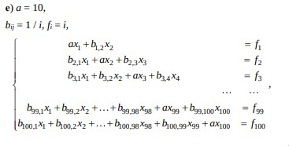
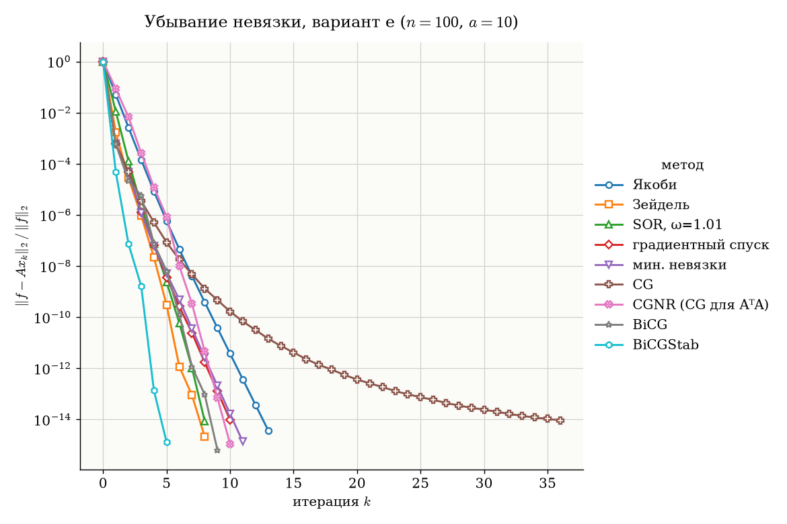
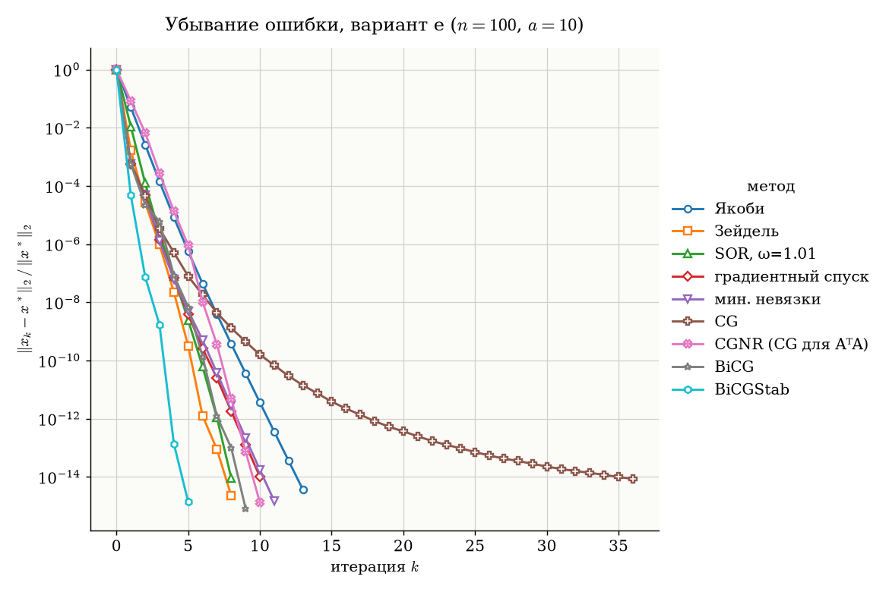

# Лабораторная работа №2. Численные методы решения СЛАУ

## 1. Задача

Решить систему линейных алгебраических уравнений $Ax = f$ прямыми и итерационными методами. Для итерационных методов построить график убывания невязки в зависимости от номера итерации.

**Вариант е.** $n = 100$, $a = 10$, $b_{ij} = 1/i$, $f_i = i$:



$$a_{ij} = \begin{cases}
a, & j = i, \\
1/i, & j < i \ \text{или} \ j = i + 1, \\
0, & j > i + 1.
\end{cases}$$

Ниже диагонали строка $i$ заполнена числами $1/i$, выше диагонали стоит один элемент $1/i$.

**Методы:**

1. метод Гаусса с выбором главного элемента;
2. LU-разложение;
3. метод Якоби;
4. метод Зейделя;
5. метод верхней релаксации (SOR);
6. метод градиентного спуска;
7. метод минимальных невязок;
8. метод сопряжённых градиентов (CG), стабилизированный метод бисопряжённых градиентов (BiCGStab) и аналоги: CG для нормальной системы (CGNR), метод бисопряжённых градиентов (BiCG).

Систему задают в начале `slau.py` константами `N`, `a` и функциями `b(i, j)`, `fi(i)`.

## 2. Свойства матрицы

| Свойство | Значение | Следствие |
|---|---|---|
| Симметрия | нет: $a_{ij} = 1/i \ne 1/j = a_{ji}$ | CG и градиентный спуск формально рассчитаны на $A = A^T > 0$ |
| Диагональное преобладание | строгое: $\sum_{j \ne i} \lvert a_{ij} \rvert = \frac{i-1}{i} + \frac1i = 1 < 10$ | LU существует без перестановок, Якоби, Зейдель и SOR ($0 < \omega < 2$) сходятся |
| $\mathrm{cond}_2(A)$ | $1.25$ | система обусловлена очень хорошо, методы сходятся быстро |

## 3. Методы

Обозначения: $r_k = f - Ax_k$ — невязка, $(u, v) = u^T v$, начальное приближение $x_0 = 0$.

### 3.1. Прямые методы

**Метод Гаусса с выбором главного элемента по столбцу.** На $k$-м шаге прямого хода среди $a_{kk}, \dots, a_{nk}$ выбирается наибольший по модулю элемент, его строка меняется местами с $k$-й, затем $x_k$ исключается из нижних строк:

$$a_{ij} \leftarrow a_{ij} - \frac{a_{ik}}{a_{kk}} a_{kj}, \quad i, j > k.$$

Обратный ход: $x_i = \left(f_i - \sum_{j > i} a_{ij} x_j\right) / a_{ii}$.

**LU-разложение.** $A = LU$, где $L$ — нижняя треугольная с единицами на диагонали, $U$ — верхняя треугольная:

$$u_{ij} = a_{ij} - \sum_{k < i} l_{ik} u_{kj} \ (j \ge i), \qquad l_{ji} = \frac{1}{u_{ii}} \left(a_{ji} - \sum_{k < i} l_{jk} u_{ki}\right) \ (j > i).$$

Затем решаются $Ly = f$ и $Ux = y$. Разложение без перестановок применимо, если все угловые миноры отличны от нуля. При строгом диагональном преобладании это выполнено.

### 3.2. Якоби, Зейдель, верхняя релаксация

**Якоби:**

$$x_i^{(k+1)} = \frac{1}{a_{ii}}\left(f_i - \sum_{j \ne i} a_{ij} x_j^{(k)}\right).$$

**Зейдель:** уже вычисленные на этой итерации компоненты сразу используются:

$$x_i^{(k+1)} = \frac{1}{a_{ii}}\left(f_i - \sum_{j < i} a_{ij} x_j^{(k+1)} - \sum_{j > i} a_{ij} x_j^{(k)}\right).$$

**Верхняя релаксация (SOR):** шаг Зейделя с весом $\omega \in (1, 2)$:

$$x_i^{(k+1)} = (1 - \omega) x_i^{(k)} + \frac{\omega}{a_{ii}}\left(f_i - \sum_{j < i} a_{ij} x_j^{(k+1)} - \sum_{j > i} a_{ij} x_j^{(k)}\right).$$

Параметр $\omega$ подобран перебором по сетке $1.01, 1.02, \dots, 1.49$: берётся значение с наименьшим числом итераций. Получилось $\omega = 1.01$.

### 3.3. Градиентный спуск и минимальные невязки

Шаг делается вдоль невязки, $x_{k+1} = x_k + \tau_k r_k$, методы отличаются выбором $\tau_k$:

$$\text{градиентный спуск:} \ \tau_k = \frac{(r_k, r_k)}{(A r_k, r_k)}, \qquad \text{минимальные невязки:} \ \tau_k = \frac{(A r_k, r_k)}{(A r_k, A r_k)}.$$

В градиентном спуске $\tau_k$ минимизирует функционал $(Ax, x) - 2(f, x)$ вдоль $r_k$, в методе минимальных невязок — норму $\lVert r_{k+1} \rVert_2$. Оба метода сходятся, если $(Ar, r) > 0$ при $r \ne 0$. Для нашей матрицы это выполнено, хотя она и несимметрична.

### 3.4. Методы крыловского типа

**Сопряжённые градиенты (CG):**

$$\alpha_k = \frac{(r_k, r_k)}{(A z_k, z_k)}, \quad x_{k+1} = x_k + \alpha_k z_k, \quad r_{k+1} = r_k - \alpha_k A z_k,$$

$$\beta_k = \frac{(r_{k+1}, r_{k+1})}{(r_k, r_k)}, \quad z_{k+1} = r_{k+1} + \beta_k z_k, \qquad z_0 = r_0.$$

Метод выведен для $A = A^T > 0$. Наша матрица несимметрична, поэтому здесь CG применён «как есть».

**CGNR** — CG для нормальной системы $A^T A x = A^T f$. Матрица $A^T A$ симметрична и положительно определена при любой невырожденной $A$.

**BiCG (бисопряжённые градиенты)** — обобщение CG на несимметричные матрицы, использует также $A^T$:

$$\alpha_k = \frac{(p_k, r_k)}{(s_k, A z_k)}, \quad x_{k+1} = x_k + \alpha_k z_k, \quad r_{k+1} = r_k - \alpha_k A z_k, \quad p_{k+1} = p_k - \alpha_k A^T s_k,$$

$$\beta_k = \frac{(p_{k+1}, r_{k+1})}{(p_k, r_k)}, \quad z_{k+1} = r_{k+1} + \beta_k z_k, \quad s_{k+1} = p_{k+1} + \beta_k s_k, \qquad p_0 = z_0 = s_0 = r_0.$$

**BiCGStab** — BiCG с дополнительным шагом минимизации невязки, без умножения на $A^T$:

$$\rho_k = (\tilde r, r_{k-1}), \quad \beta_k = \frac{\rho_k}{\rho_{k-1}} \frac{\alpha_{k-1}}{\omega_{k-1}}, \quad p_k = r_{k-1} + \beta_k (p_{k-1} - \omega_{k-1} v_{k-1}), \quad v_k = A p_k,$$

$$\alpha_k = \frac{\rho_k}{(\tilde r, v_k)}, \quad s_k = r_{k-1} - \alpha_k v_k, \quad t_k = A s_k, \quad \omega_k = \frac{(t_k, s_k)}{(t_k, t_k)},$$

$$x_k = x_{k-1} + \alpha_k p_k + \omega_k s_k, \quad r_k = s_k - \omega_k t_k, \qquad \tilde r = r_0, \ \rho_0 = \alpha_0 = \omega_0 = 1, \ v_0 = p_0 = 0.$$

### 3.5. Критерий остановки

$$\frac{\lVert r_k \rVert_2}{\lVert f \rVert_2} < 10^{-14},$$

не более $1000$ итераций.

## 4. Запуск

```bash
python3 slau.py
```

Нужны `numpy` и `matplotlib`. Скрипт печатает таблицу результатов и сохраняет графики `resid.png` и `error.png`. Точное решение $x^*$ для оценки ошибки получено через `numpy.linalg.solve`.

## 5. Результаты

$$x^* = (0.081803,\ 0.181974,\ 0.278718,\ 0.374679,\ 0.470339,\ \dots,\ 9.328946,\ 9.424175,\ 9.529038).$$

| Метод | Итераций | $\lVert r \rVert / \lVert f \rVert$ | $\lVert x - x^* \rVert / \lVert x^* \rVert$ |
|---|---|---|---|
| Гаусс | — | $4.6 \cdot 10^{-16}$ | $0$ |
| LU | — | $1.0 \cdot 10^{-16}$ | $4.7 \cdot 10^{-16}$ |
| Якоби | 13 | $3.7 \cdot 10^{-15}$ | $3.6 \cdot 10^{-15}$ |
| Зейдель | 8 | $2.1 \cdot 10^{-15}$ | $2.3 \cdot 10^{-15}$ |
| SOR, $\omega = 1.01$ | 8 | $8.6 \cdot 10^{-15}$ | $9.1 \cdot 10^{-15}$ |
| Градиентный спуск | 10 | $9.6 \cdot 10^{-15}$ | $1.0 \cdot 10^{-14}$ |
| Минимальные невязки | 11 | $1.4 \cdot 10^{-15}$ | $1.5 \cdot 10^{-15}$ |
| CG | 36 | $9.2 \cdot 10^{-15}$ | $8.5 \cdot 10^{-15}$ |
| CGNR | 10 | $1.1 \cdot 10^{-15}$ | $1.3 \cdot 10^{-15}$ |
| BiCG | 9 | $6.5 \cdot 10^{-16}$ | $8.4 \cdot 10^{-16}$ |
| BiCGStab | 5 | $1.3 \cdot 10^{-15}$ | $1.4 \cdot 10^{-15}$ |

Ошибка метода Гаусса равна нулю, потому что `numpy.linalg.solve` решает систему тем же алгоритмом (LU с выбором главного элемента по столбцу).

### Убывание невязки



### Убывание ошибки



## 6. Анализ

**Логарифмический масштаб превращает геометрическую прогрессию в прямую.** Если $\lVert r_k \rVert \approx C q^k$, то $\lg \lVert r_k \rVert = \lg C + k \lg q$, то есть прямая с наклоном $\lg q$. Чем круче прямая, тем быстрее метод. Почти все кривые — прямые: невязка уменьшается в постоянное число раз за итерацию.

**Невязка и ошибка ведут себя одинаково.** $\lVert e_k \rVert \le \lVert A^{-1} \rVert \lVert r_k \rVert$ и $\lVert r_k \rVert \le \lVert A \rVert \lVert e_k \rVert$, поэтому относительные невязка и ошибка отличаются не более чем в $\mathrm{cond}(A) = 1.25$ раза, и графики практически совпадают. Для плохо обусловленной системы малая невязка ещё не означала бы малую ошибку.

**Якоби** уменьшает невязку примерно в 10 раз за итерацию: недиагональные элементы строки в сумме дают $1$, диагональ равна $10$.

**Зейдель** быстрее Якоби: 8 итераций против 13, потому что новые компоненты сразу используются в той же итерации.

**Верхняя релаксация не ускоряет сходимость.** Наименьшее число итераций при $\omega > 1$ получилось на краю сетки, при $\omega = 1.01$, и совпадает с Зейделем (8). При больших $\omega$ итераций становится больше. Для такой хорошо обусловленной системы Зейдель уже почти оптимален.

**Градиентный спуск и минимальные невязки** почти совпадают: 10–11 итераций. Первый шаг особенно удачный: невязка падает в $\sim 10^3$ раз, так как $r_0 = f$ почти собственный вектор $A$.

**CG на несимметричной матрице** первые два шага идёт наравне с градиентным спуском, затем замедляется и требует 36 итераций. Формулы CG выведены для $A = A^T$. Для несимметричной матрицы направления $z_k$ перестают быть $A$-сопряжёнными, и метод теряет свои свойства.

**CGNR** исправляет это переходом к симметричной $A^TA$: гладкая сходимость за 10 итераций.

**BiCG и BiCGStab** рассчитаны на несимметричные матрицы. BiCG сходится немонотонно, BiCGStab — быстрее всех, за 5 итераций.

**Предел точности.** Все методы останавливаются на $\lVert r \rVert / \lVert f \rVert \sim 10^{-15}$: дальше невязку не уменьшить из-за ошибок округления в `double`.

## 7. Выводы

1. Все методы решают систему варианта е и дают одно решение с относительной ошибкой $\lesssim 10^{-14}$. Прямые методы дают точность $\sim 10^{-16}$.
2. Строгое диагональное преобладание гарантирует применимость LU без перестановок и сходимость Якоби, Зейделя и SOR.
3. Самые быстрые по числу итераций — BiCGStab (5), Зейдель и SOR (8), BiCG (9).
4. Верхняя релаксация ($\omega > 1$) для этой системы не даёт выигрыша по сравнению с Зейделем.
5. Классический CG на несимметричной матрице сходится в 3–4 раза медленнее, чем CGNR и BiCG. Для несимметричных систем подходят BiCGStab, BiCG или CG для нормальной системы.
6. Из-за малого числа обусловленности ($1.25$) графики невязки и ошибки практически совпадают.
